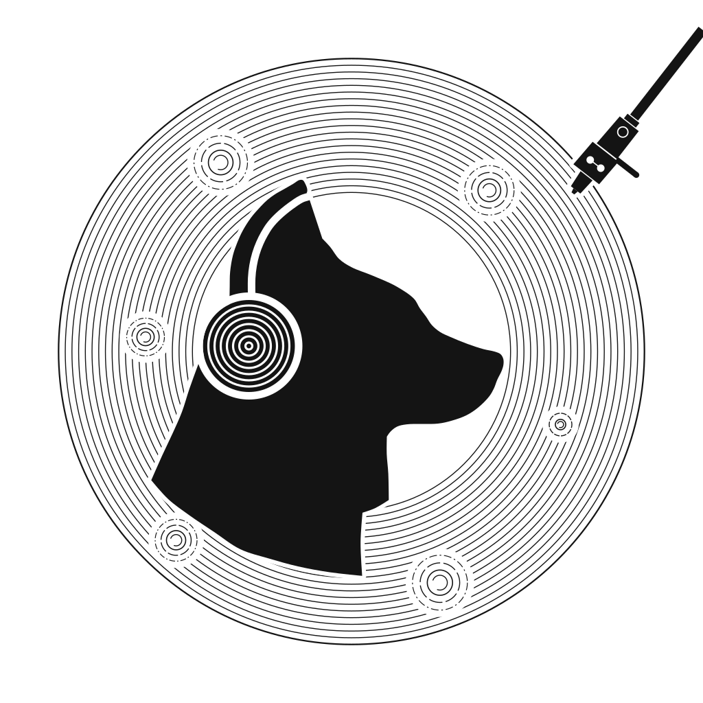
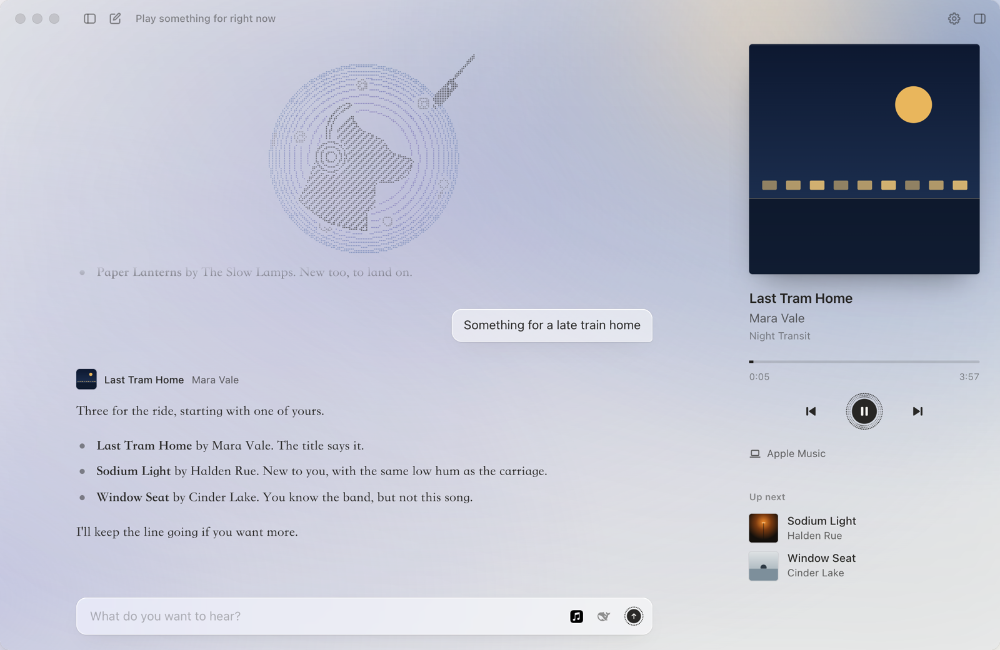
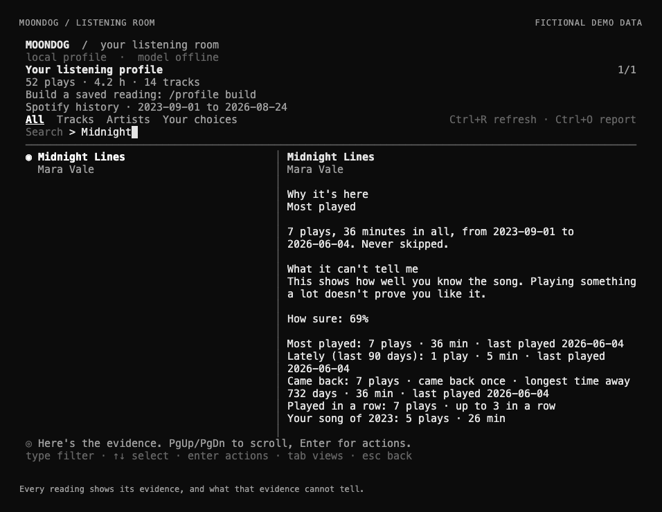
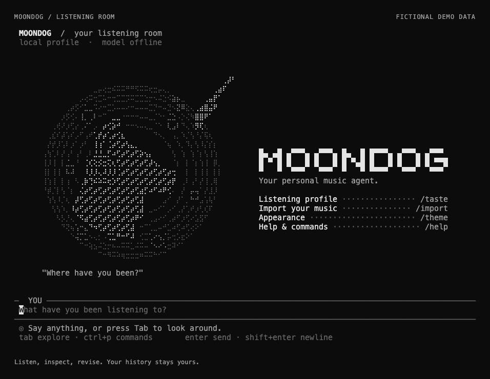

<p align="center">
  
</p>

<h1 align="center">Moondog</h1>

<p align="center">Version 0.3.1</p>

<p align="center"><strong>On the air, just for you.</strong></p>

<p align="center">
  <picture>
    <source media="(prefers-color-scheme: dark)" srcset="assets/demo/moondog-desktop-dark.png">
    
  </picture>
</p>

<p align="center"><sub>The desktop app, with a made-up listener. The <a href="https://moondog.audiofool.ai">project page</a> plays the whole scene.</sub></p>

Moondog is a radio host just for you.
It reads the history your music services already keep, learns your taste from it, and plays music for you on Spotify, Apple Music, or NetEase Music.
Ask it for something, and it answers like a host: what it picked, and why each song is there.
On a Mac it can also go on air with music it makes itself.

There are two clients on one core: a desktop app and a listening room in your terminal.
They share your profile, settings, sign-ins, and conversations.
Your profile works without a model, an API key, or a music-service login, and your data stays on your machine.
The agent is built on [Pi](https://github.com/earendil-works/pi).

## Get Moondog

| Where | How |
| --- | --- |
| Mac, Apple silicon | Download the signed, notarized app from the [project page](https://moondog.audiofool.ai) or [Releases](https://github.com/Audiofool934/moondog/releases/latest). |
| Windows, x64 | A test build from the same places. It is not code-signed yet, so SmartScreen asks before it opens. |
| Terminal, macOS or Linux | `npm install --global @audiofool/moondog`, then `moondog`. Needs Node.js 22.19.0 or newer. |

The [getting-started guide](https://moondog.audiofool.ai/start.html) goes from the first run to the first song: the music service, the model, and your history.

The desktop app updates itself, on a Stable or Beta channel you choose in Settings › About.
The terminal updates with `moondog update` or `/update`, on the npm `latest` or `beta` channel.
See [updating and release channels](docs/UPDATES.md).

To run from this checkout:

```bash
git clone https://github.com/Audiofool934/moondog.git
cd moondog
npm ci
npm start
```

`npm run demo` shows the agent at work on fictional data, with no sign-in at all.
`cd app && npm ci && npm start` opens the desktop app; [app/README.md](app/README.md) covers its builds for macOS, Windows, and Linux.

## Where it plays

| Service | What you get |
| --- | --- |
| Apple Music | Whole songs in the Mac app with a subscription; 30-second previews elsewhere, each with a link to the full song. |
| Spotify | Playback on your active device, after you connect your account. |
| NetEase Music | Whole songs through NetEase's own `ncm-cli`, for listeners in mainland China. |

Pick the service beside the send button, or with `/service` in the terminal.
Moondog also sees what you already play: the song and playlist in the Music app on a Mac, or on Spotify's active device, so “more like this playlist” needs no names.
The Windows build plays Spotify and Apple Music previews; whole Apple Music songs and reading the Music app need macOS.

## A model to talk through

Testers with an invite code can use Moondog's own model, with no account and no API key.
Enter the code in Settings, or type `/invite <code>` in the terminal.

Or bring your own.
GLM, Kimi, DeepSeek, Grok, GPT, Claude, Gemini, and OpenRouter are built in, and OpenAI takes your ChatGPT subscription or an API key.
Any service that speaks OpenAI's or Anthropic's API can be added by its address, in Settings or with `/endpoint`.
You can switch models in the middle of a conversation, or change settings by asking, such as the model or the language it replies in.
The [model setup guide](docs/TERMINAL_GUIDE.md#enable-agent-conversation) lists each provider.

## Bring your history

Import in the desktop app's Settings › Import, or drop the file on its window; in the terminal, type `/import`.
Moondog shows you what is inside before anything is saved, and the original files are never touched.

| Service | What you can bring |
| --- | --- |
| Spotify | Recent plays after you connect, or the whole history from the ZIP Spotify emails you. |
| Apple Music | The Library.xml you export from Music on a Mac. |
| YouTube Music | A Google Takeout export. |
| Last.fm | Your scrobbles and loved tracks, read by username. |
| QQ Music and NetEase | Any public playlist, from its share link. |
| ListenBrainz | A saved listens file. |

The [terminal guide](docs/TERMINAL_GUIDE.md#import-and-inspect-listening-history) has every format.

With a model connected, Moondog writes a reading of everything you imported, usually in a few minutes.
It names the threads in your listening, keeps what you played apart from what you saved, and marks its interpretations as interpretations.
A second pass checks the draft for contradictions and invented claims, and the build fixes what it finds before saving.

## Your profile

The profile says what you played, and what that cannot prove.
Playing a song a lot does not, on its own, establish how much it matters to you.

<p align="center">
  
</p>

<p align="center"><sub>The terminal's profile, with fictional data: the evidence, and the limit of that evidence.</sub></p>

Open it from Taste in the desktop app's sidebar (⌥⌘T), or with `/taste` in the terminal.
Find a song or artist, see why it is there, and choose **I like this** or **Keep it out**; the profile updates in place, and **Undo my choice** puts it back.
You can also say it to the host, for example “never play this again”.
`/taste report` walks the years one song at a time and ends on what play counts can never tell anyone; you can keep it as a private page that works offline.

## On the air

Ask for music in your own words, in any of ten languages.
Each step shows in the conversation as it happens, and the host checks every recording on your service before it plays or queues it.
What it reads about the wider music world stays separate from what it knows about you, and songs it chose for you do not count as your own taste.
Under a set of songs, one line names the mix: how many you know well, how many come back after a while, and how many are new to you.

- **Up next.** The desktop player shows the queue: play a song now, or take one out. When it runs low, the host offers a few picks.
- **Your library.** Saved songs, your playlists, and the tracks Moondog made sit side by side. Import a Spotify, Apple Music, NetEase Music, or QQ Music playlist by its link, and export a playlist to Spotify.
- **Music it makes.** On an Apple silicon Mac, Moondog makes instrumental tracks offline with Stable Audio 3, powered by Stability AI. Set it up once in Settings › Playback, or with `/generation download medium`, after you agree to its licenses.
- **On Air.** Press the On Air mark, ⌃⌘O, or type `/onair`, and Moondog keeps making music from your taste until you stop it.

## The terminal room

<p align="center">
  
</p>

<p align="center"><sub>The real terminal room, in charcoal, with fictional data.</sub></p>

The terminal opens on a record sleeve drawn in characters, with a lyric from music you have played.
Moondog asks [LRCLIB](https://lrclib.net/) for the original words only, and sends nothing about you.
The room is black and white, like the moon: `/theme paper`, `/theme charcoal`, or `/theme terminal` for your own colors.
Tab on an empty input steps onto the tracklist, and Ctrl+P searches every command.

| Command | What it does |
| --- | --- |
| `/taste` | Open your profile. |
| `/import` | Bring your history. |
| `/library` | Your saved songs and playlists. |
| `/onair` | Go on air, or come off it. |
| `/skip`, `/stop` | Skip to the next song or stream track, or stop. |
| `/resume`, `/new` | Pick up a saved conversation, or start a fresh one. |
| `/rewind`, `/branch` | Change an earlier message, or go on in a new conversation. |
| `/home` | Back to the sleeve, without clearing the conversation. |
| `/help` | Everything else. |

The [terminal guide](docs/TERMINAL_GUIDE.md) has every command and key.

## Your data

Your profile never touches the network.
The agent talks only to the services you set up, and the profile builder sends a compact summary of your music evidence to your model only when you ask for a build.
Web search sends the question or the link you give it, and nothing from your profile, history, or files.
An image you attach goes to the model that reads it.
A Spotify ZIP does not need a Spotify sign-in.
Read the [connection and data details](docs/TERMINAL_GUIDE.md) before you connect anything.

## Further

- [Terminal guide](docs/TERMINAL_GUIDE.md): import formats, commands, appearance, models, Spotify, memory, and your local data.
- [Desktop app](app/README.md): the window, its keys, builds, and updates.
- [Project page](site/README.md): how the page plays the scene in the app's real window, in a browser, on made-up data.
- [Private Tasteprint](docs/PRIVATE_TASTEPRINT.md): what the evidence can support, and what a report reveals about you.
- [Product charter](docs/PRODUCT_CHARTER.md) and [public roadmap](docs/ROADMAP.md): where Moondog is headed, and what it will not do.
- [Voice](docs/VOICE.md): how Moondog talks, and where Pink Floyd shows up.
- [The listening loop](docs/LISTENING_LOOP.md): how the agent keeps your choices, your recent listening, and its own picks apart.
- [The agent harness](docs/AGENT_HARNESS.md): how the tools keep the model's part small, so every supported model can play what you ask.
- [Runtime architecture](docs/ADR_0001_AGENT_RUNTIME_AND_CLI.md) and [data contracts](contracts/README.md): how the pieces fit together.
- [Contribution guide](CONTRIBUTING.md): local setup, checks, and how private data is kept out.
- [Release status](docs/PUBLIC_RELEASE_READINESS.md): what is published, and what the checks cover.
- [Translating Moondog](docs/TRANSLATING.md): how replies choose a language, and how to add one.

## License

Moondog is open source under the [Apache License 2.0](LICENSE).
Copyright 2026 Audiofool.
Music making runs Stable Audio 3, which Moondog downloads from Stability AI when you ask, or your own install; [NOTICE](NOTICE) holds its attribution, and [licenses/](licenses/stability-ai-community-license.md) holds the Stability AI Community License.
