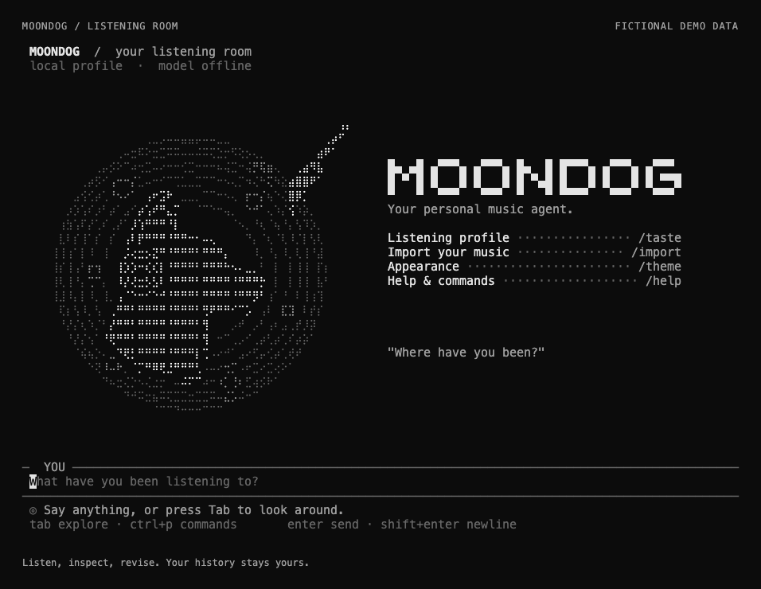
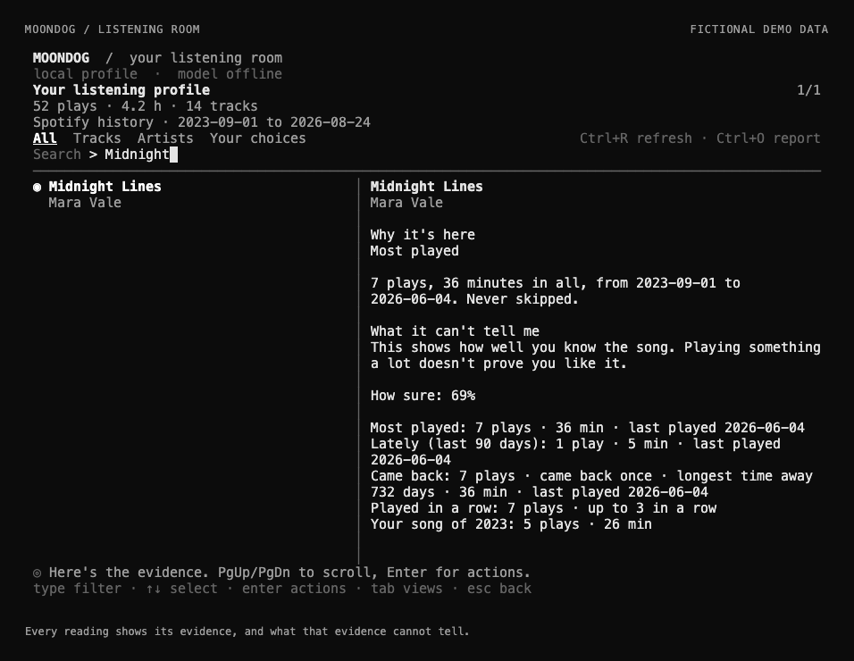

<p align="center">
  
</p>

<h1 align="center">Moondog</h1>

<p align="center">Version 0.2.1</p>

<p align="center"><strong>A listening room that shows its work.</strong></p>

<p align="center">
  
</p>

<p align="center"><sub>The real TUI, in charcoal, with fictional listening data.</sub></p>

Moondog is a listening room in your terminal.
It reads the history your music services already keep, and turns it into a profile you can open, question, and correct.
The profile works without a model, an API key, or a music-service login.
When you want company, an agent can talk music with you, find songs you have not heard, and shape a playlist.
Your data stays on your machine.
The room is built on [Pi](https://github.com/earendil-works/pi).

## Open the room

You need Node.js 22.19.0 or newer, on macOS or Linux.
Install from this checkout to run the room shown here.

```bash
git clone https://github.com/Audiofool934/moondog.git
cd moondog
npm ci
npm start
```

[@audiofool/moondog](https://www.npmjs.com/package/@audiofool/moondog) 0.2.0 is the published package; `npm install --global @audiofool/moondog` installs it.
To see the agent work through fictional data, with no sign-in at all, run `npm run demo` from the checkout.

The source version supports `moondog update` and `/update`, with stable (`latest`) and preview (`beta`) channels.
Startup checks show a quiet notification; installation happens only when you request it.
See [updating and release channels](docs/UPDATES.md), including the one-time upgrade needed for the older npm 0.1.0 package.

## Other ways in

[Moondog for Mac](app/README.md) is a native window on the same core as the terminal room.
It shares your profile, settings, sign-ins, and conversations with `moondog`, and draws its own conversation, now playing, and up next.
Run it from this checkout with `cd app && npm ci && npm start`.

The [project page](https://moondog.audiofool.ai) plays a short scene in this window, in a browser, with a made-up listener ([how](site/README.md)).

## The sleeve

The opening is a record sleeve drawn in characters.
Nothing in the terminal is a picture.
On a wide screen the record sits beside the title, with the wordmark level with the dog's eye.
On a tall or narrow screen the record stacks above the title.
Moondog uses whichever arrangement leaves the record larger.
A lyric rests midway between the record and the input box, with room on both sides.
The input asks what you have been listening to.

Until your library has a line of its own, the sleeve rotates three short ones: "Where have you been?", "Is there anybody out there?", and "Wish you were here."
When a matching line from music you have played is available, that line takes the place.
Moondog asks [LRCLIB](https://lrclib.net/) for the original words only, and does not send your profile, your history, or the conversation.

The room is black and white, like the moon.
Paper is black ink on white.
Charcoal is moonlight on a black sky.
`/theme terminal` keeps your own colors.
The only other colors are the six from the prism on *The Dark Side of the Moon*.
Red means a step failed, orange is a caution, green confirms, and the spectrum shows while Moondog is working.

Press Tab on an empty input to step onto the tracklist, then use the arrow keys and Enter.

| On the sleeve | Command |
| --- | --- |
| Listening profile | `/taste` |
| Import your music | `/import` |
| Appearance | `/theme` |
| Help & commands | `/help` |

While the room is idle, lunar marks travel the record, a highlight follows the groove, and the needle pulses.
The dog and the wordmark stay still.
`/motion off` holds the sleeve.
`/art ascii` switches the drawing.
`/home` returns here and leaves the conversation where it was.

## Bring your history

Type `/import` and pick a service.
Moondog shows you what is inside before anything is saved.
When the import finishes, your profile opens in the same TUI session.

| Service | What you can bring |
| --- | --- |
| Spotify | Recent plays after you connect, or the whole history from the ZIP Spotify emails you. |
| Apple Music | The Library.xml you export from Music on a Mac. |
| YouTube Music | A Google Takeout export. |
| Last.fm | Your scrobbles and loved tracks, read by username. |
| QQ Music and NetEase | Any public playlist, from its share link. |
| ListenBrainz | A saved listens file. |

A Spotify ZIP can also go straight in.

```text
/import "/path/to/spotify-history.zip"
```

Importing the same file twice changes nothing, and your original files are never touched.
Apple's privacy download, and full QQ or NetEase listening history, are not supported yet.
The [terminal guide](docs/TERMINAL_GUIDE.md#import-and-inspect-listening-history) has every format.

With a connected model, `/profile build` writes a reading of everything you imported, usually in a few minutes.
It names the threads in your listening, keeps what you played apart from what you saved, and marks its interpretations as interpretations.
A second pass checks the draft for contradictions and invented claims, and the build fixes what it finds before saving.
Use `/profile saved` to read it and `/profile explain 1` to trace a finding to its evidence, including after restarting.
New imports or corrections mark it for an update; a cancelled build keeps its draft and your previous reading.
The builder sends a compact summary of your music evidence to your configured model when you ask for it.

## Your profile

The profile says what you played, and what that cannot prove.
Playing a song a lot does not, on its own, establish how much it matters to you.

<p align="center">
  
</p>

<p align="center"><sub>Fictional data, with the evidence and the limit of that evidence.</sub></p>

| In the profile | What you can do |
| --- | --- |
| Find a song or artist | Type to filter, then open it. |
| See why it is there | Read what you played, what that cannot prove, and what you told Moondog, each on its own. |
| Make a choice | Choose **I like this** (Like) or **Keep it out** (Avoid), and the profile updates in place. You can also say it to the agent, for example “never play this again”. |
| Change your mind | Choose **Undo my choice**, and the original listening history never changes. |
| Find more like this | Start an editable request for three songs, from the track you picked. |

Type `/taste report` for the long view.
It walks the years one song at a time, names songs that went quiet and songs that came back, and ends on the dark side of the moon: what play counts can never tell anyone.
You can save that report as a private page that works offline.

## An agent, when you want one

Sign in with `/auth`, then pick a model with `/model`.
GLM, Kimi, DeepSeek, Grok, GPT, Claude, Gemini, and OpenRouter are there.
OpenAI takes your ChatGPT subscription or an API key.
In the Mac app, any service that speaks OpenAI's or Anthropic's API can be added as an endpoint by its address, and `/endpoint` does it in the terminal.
You can switch models in the middle of a conversation.
The [model setup guide](docs/TERMINAL_GUIDE.md#enable-agent-conversation) lists each provider and the environment variable it reads.

While an answer is on the way, each step appears in the conversation as it starts.
The steps stay above the reply, with a count of what finished, what failed, and what was not confirmed.
The agent can use musical knowledge and web research to find candidates, then verify the recordings on Spotify before playing or queueing them.
Without Spotify, it plays 30-second Apple Music previews from the terminal instead, each next to a link to the full song.
It also sees what you already play: the song and playlist in the Music app on a Mac, or on Spotify's active device, so “more like this playlist” needs no names.
macOS asks once before Moondog may read the Music app.
For example, “Pon doce de salsa clásica a la cola” asks it to add up to twelve verified songs directly; your history guides the choice without limiting it to your library.
What it reads about the wider music world stays separate from what it knows about you.
Under a queue or a set of songs, one line names the mix: how many you know well, how many come back after a while, and how many are new to you.
Songs Moondog chose for you do not count as your own taste.

| Optional connection | What it adds |
| --- | --- |
| A model through Pi | Conversation, discovery, and playlists built together. |
| A web search service | `/web` lookups with links to their sources, through DeepSeek (`/auth deepseek`, which also reads pages), Brave Search (`/auth brave`), or your own signed-in Codex CLI. |
| Spotify sign-in | Playback, and private playlists made only when you ask. |

Your profile never touches the network.
The agent talks only to the services you set up.
`/web` sends the question or the link you give it, and nothing from your profile, history, or files.
A Spotify ZIP does not need a Spotify sign-in.
Read the [connection and data details](docs/TERMINAL_GUIDE.md) before you connect anything.

## Getting around

| Command or key | What it does |
| --- | --- |
| `/taste` | Open your profile. |
| Type, arrow keys, Enter | Filter, pick a row, and see why it is there, or make a choice. |
| Tab in the profile | Switch between All, Tracks, Artists, and Your choices. |
| Tab on the sleeve | Step onto the tracklist, then press Escape to return to the line you were writing. |
| Esc | Go back, and the draft stays put. |
| Ctrl+P | Search every command. |
| Page Up, Page Down | Move through the conversation while the header, the draft, and the status line stay put. |
| Up and Down in the draft | Recall what you typed in this conversation. |
| Enter while Moondog is working | Queue the next message. It sends when this one finishes. |
| `/resume`, `/new` | Pick up a saved conversation, or start a fresh one. |
| `/home` | Back to the sleeve, without clearing the conversation. |
| `/skip`, `/stop` | Skip to the next song preview, or stop the previews. |
| `/lyrics` | See which line is on the sleeve, and which song it came from. |
| `/theme paper` | Black ink on white. |
| `/theme charcoal` | Moonlight on a black sky. |
| `/theme terminal` | Your terminal's own colors. |
| `/language` | Choose the language Moondog replies in: English, 简体中文, 繁體中文, 日本語, 한국어, Español, Français, Deutsch, Português (Brasil), or Italiano. Screens follow in English, Español, Português (Brasil), 日本語, and 简体中文. |

Each launch starts a new conversation.
Your profile, and anything Moondog remembers, carry over.

## Further

- [Terminal guide](docs/TERMINAL_GUIDE.md): import formats, commands, appearance, models, Spotify, memory, and your local data.
- [Private Tasteprint](docs/PRIVATE_TASTEPRINT.md): what the evidence can support, and what a report reveals about you.
- [Product charter](docs/PRODUCT_CHARTER.md) and [public roadmap](docs/ROADMAP.md): where Moondog is headed, and what it will not do.
- [Voice](docs/VOICE.md): how Moondog talks, and where Pink Floyd shows up.
- [The listening loop](docs/LISTENING_LOOP.md): how the agent keeps your choices, your recent listening, and its own picks apart.
- [Runtime architecture](docs/ADR_0001_AGENT_RUNTIME_AND_CLI.md) and [data contracts](contracts/README.md): how the pieces fit together.
- [Contribution guide](CONTRIBUTING.md): local setup, checks, and how private data is kept out.
- [Release status](docs/PUBLIC_RELEASE_READINESS.md): what is published, and what the checks cover.
- [Translating Moondog](docs/TRANSLATING.md): how replies choose a language, and how to add one.

## License

Moondog is open source under the [Apache License 2.0](LICENSE).
Copyright 2026 Audiofool.
